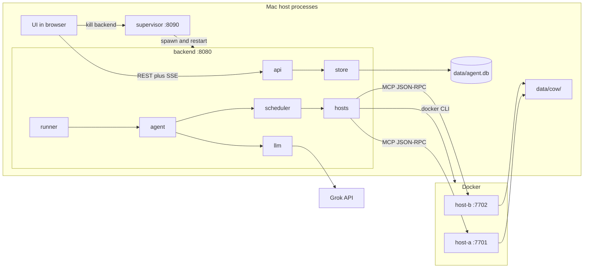
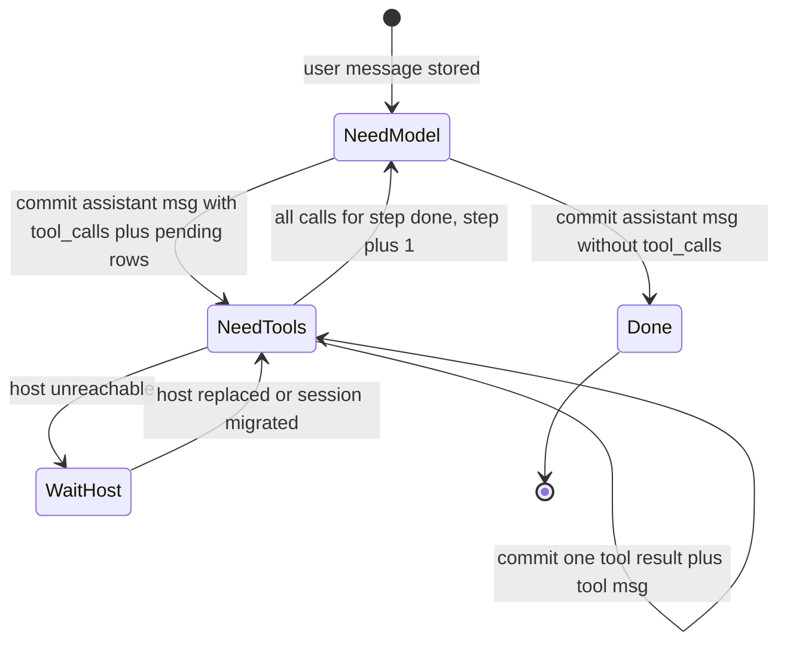

# Local fault-tolerant coding agent: execution plan

Four-hour prototype. A browser UI, a restartable ReAct backend that keeps all state in SQLite, and two Docker daemon hosts that run file tools against copy-on-write workspaces stored in a fixed directory on the Mac. The demo must survive two failures: a daemon host dies mid-run, and the ReAct backend dies mid-run.

## Design rules

These rules keep the separation clean and the code small.

1. **One owner per kind of state.** SQLite (backend) owns conversation, tool log, leases, and host registry. The Mac directory `data/cow/` (daemon) owns files. The UI owns nothing; it can be reloaded at any time.
2. **Only the daemon touches workspace files.** The backend never reads `data/cow/` directly, even though it could.
3. **Commit before side effect.** The backend writes the intent to SQLite before calling the model or a tool, and writes the result in the same transaction that advances the step.
4. **Every remote call carries a deterministic id.** Session creation uses an `Idempotency-Key`. Tool calls use `op_id = {session_id}.{step}.{call_index}`. Retrying any call with the same id is safe.
5. **No in-memory state that matters.** Kill any process at any line; on restart, state is rebuilt from SQLite and `data/cow/`.
6. **Minimal dependencies.** Backend: FastAPI, uvicorn, httpx. Daemon: Python stdlib only (the [Dockerfile](Dockerfile) installs nothing with pip). UI: one HTML file, vanilla JS, no build step.

## Component breakdown



### File layout

```
coding-agent/
  dummy-repo/                 seed repository baked into the image
  daemon/
    server.py                 HTTP routing only (ThreadingHTTPServer)
    workspace.py              base seeding + per-session CoW ensure
    tools.py                  tool registry, schemas, path confinement
    journal.py                op_id result journal (idempotency)
    fsutil.py                 atomic_write, link_copy_tree, fsync helpers
  backend/
    requirements.txt
    config.py                 env loading, constants
    db.py                     connection, PRAGMAs, schema, migrations
    store.py                  all SQL lives here; typed functions only
    events.py                 append event + in-process pub/sub fan-out
    llm.py                    OpenAI-compatible streaming client + mock model
    hosts.py                  DaemonClient (HTTP) + DockerControl (docker CLI)
    scheduler.py              host pick, health monitor, failover/replace
    agent.py                  ReAct step machine for one session
    runner.py                 session lease claim/renew, task per session
    api.py                    FastAPI routes, SSE, static UI mount
    supervisor.py             parent process, restart loop, kill endpoint
  ui/
    index.html  app.js  styles.css
  tests/
  scripts/
    dev.sh                    compose up + start supervisor
    kill_host.sh              docker kill coding-agent-host-<x>
```

Dependency direction is one way: `api -> runner -> agent -> {llm, scheduler -> hosts}`, and everything that persists goes through `store`. `agent` does not import `api`, and `hosts` does not import `store`.

## Database schema (`data/agent.db`)

Opened with `PRAGMA journal_mode=WAL; PRAGMA synchronous=FULL; PRAGMA foreign_keys=ON; PRAGMA busy_timeout=5000;`. Every timestamp is a unix epoch `REAL`. One process writes, using a single connection behind a `threading.Lock`; async code calls it through `asyncio.to_thread`.

```sql
CREATE TABLE IF NOT EXISTS hosts (
  host_id              TEXT PRIMARY KEY,          -- 'host-a'
  endpoint             TEXT NOT NULL,             -- 'http://127.0.0.1:7701'
  container_name       TEXT NOT NULL,             -- 'coding-agent-host-a'
  port                 INTEGER NOT NULL,          -- 7701
  generation           INTEGER NOT NULL DEFAULT 1,-- +1 on every replacement
  boot_id              TEXT,                      -- reported by daemon /health
  status               TEXT NOT NULL DEFAULT 'unknown'
                       CHECK (status IN ('unknown','healthy','suspect','replacing','down')),
  consecutive_failures INTEGER NOT NULL DEFAULT 0,
  last_heartbeat_at    REAL,
  updated_at           REAL NOT NULL
);

CREATE TABLE IF NOT EXISTS sessions (
  session_id        TEXT PRIMARY KEY,             -- 's_' + uuid4 hex[:12]
  idempotency_key   TEXT UNIQUE,                  -- from POST header
  title             TEXT NOT NULL,
  prompt            TEXT NOT NULL,
  status            TEXT NOT NULL
                    CHECK (status IN ('queued','running','waiting_host',
                                      'completed','failed','cancelled')),
  step              INTEGER NOT NULL DEFAULT 0,   -- completed ReAct rounds
  max_steps         INTEGER NOT NULL,
  host_id           TEXT REFERENCES hosts(host_id),
  host_generation   INTEGER,                      -- generation at assignment
  lease_owner       TEXT,                         -- backend instance id
  lease_expires_at  REAL,
  final_answer      TEXT,
  error             TEXT,
  created_at        REAL NOT NULL,
  updated_at        REAL NOT NULL
);
CREATE INDEX IF NOT EXISTS sessions_runnable
  ON sessions(status, lease_expires_at);

-- Durable LLM conversation. Exactly what is sent to the model on resume.
CREATE TABLE IF NOT EXISTS messages (
  session_id       TEXT NOT NULL REFERENCES sessions(session_id),
  idx              INTEGER NOT NULL,              -- 0..n, dense
  role             TEXT NOT NULL CHECK (role IN ('system','user','assistant','tool')),
  content          TEXT,
  tool_calls_json  TEXT,                          -- assistant: OpenAI tool_calls array
  tool_call_id     TEXT,                          -- tool: id it answers
  step             INTEGER NOT NULL,
  created_at       REAL NOT NULL,
  PRIMARY KEY (session_id, idx)
);

-- Current state of each tool call. One row per op_id.
CREATE TABLE IF NOT EXISTS tool_calls (
  op_id            TEXT PRIMARY KEY,              -- '{session_id}.{step}.{call_index}'
  session_id       TEXT NOT NULL REFERENCES sessions(session_id),
  step             INTEGER NOT NULL,
  call_index       INTEGER NOT NULL,
  model_call_id    TEXT NOT NULL,                 -- id the model gave the call
  tool_name        TEXT NOT NULL,
  args_json        TEXT NOT NULL,
  status           TEXT NOT NULL
                   CHECK (status IN ('pending','running','succeeded','failed')),
  attempts         INTEGER NOT NULL DEFAULT 0,
  host_id          TEXT,                          -- host of last attempt
  host_generation  INTEGER,
  replayed         INTEGER NOT NULL DEFAULT 0,    -- 1 if daemon returned journaled result
  result_json      TEXT,
  error            TEXT,
  created_at       REAL NOT NULL,
  started_at       REAL,
  finished_at      REAL,
  UNIQUE (session_id, step, call_index)
);
CREATE INDEX IF NOT EXISTS tool_calls_session ON tool_calls(session_id, step, call_index);

-- Append-only temporal log. Source of truth for the UI timeline and SSE replay.
CREATE TABLE IF NOT EXISTS events (
  seq           INTEGER PRIMARY KEY AUTOINCREMENT, -- global, used as SSE id
  session_id    TEXT,                              -- NULL for host/backend events
  ts            REAL NOT NULL,
  type          TEXT NOT NULL,
  op_id         TEXT,
  host_id       TEXT,
  payload_json  TEXT NOT NULL DEFAULT '{}'
);
CREATE INDEX IF NOT EXISTS events_session_seq ON events(session_id, seq);
```

`tool_calls` holds the current state of each call. `events` is the temporal history: every attempt, retry, host change, and result is a separate row with a timestamp, so the full timeline of a tool call can be rebuilt with `SELECT * FROM events WHERE op_id = ? ORDER BY seq`.

### Event types

- Session: `session.created`, `session.claimed {owner, resumed}`, `session.status {from, to}`, `session.completed {final_answer}`, `session.failed {error}`.
- Model: `llm.started {step}`, `llm.retry {attempt, reason, backoff_s}`, `assistant.message {step, content, tool_calls}`.
- Tool: `tool.pending`, `tool.started {attempt, host_id, generation}`, `tool.succeeded {replayed, duration_ms, summary}`, `tool.failed {error, retryable}`, `tool.retrying {reason, backoff_s}`.
- Host: `host.healthy`, `host.suspect {failures}`, `host.down`, `host.replacing`, `host.replaced {generation, boot_id}`, `session.migrated {from, to}`.
- Backend: `backend.started {instance_id}` (`session_id` is NULL).
- Ephemeral, never stored: `assistant.delta {text}`. These are pushed only to live SSE subscribers. If the backend dies mid-stream the partial text is lost and the model is called again; only the final `assistant.message` is stored.

## Daemon (runs in each container)

### HTTP surface

- `GET /health` returns `{host_id, boot_id, base_ready, uptime_s}`. `boot_id` is a new uuid on every process start, so the backend can tell a replacement from the original.
- `POST /workspaces` with `{session_id}` returns `{path, created}`. It is idempotent.
- `POST /mcp` takes MCP-style JSON-RPC 2.0:
  - `tools/list` returns `{tools: [{name, description, inputSchema}]}`
  - `tools/call` with `{name, arguments, _meta: {session_id, op_id}}` returns `{content: [{type: "text", text}], isError, _meta: {op_id, replayed, host_id, boot_id}}`

### Tools (file operations only, all confined to the session workspace)

- `list_dir(path=".", depth=1)`
- `read_file(path, start_line?, end_line?)`
- `search(pattern, path=".", glob?)` uses regex over files, capped at 200 hits.
- `write_file(path, content)` creates parent dirs and writes atomically.
- `replace_in_file(path, old, new)` requires `old` to appear exactly once. If `old` is gone and `new` is present, it reports `already_applied` so a re-run after a crash still succeeds.
- `mkdir(path)` uses `exist_ok`.
- `delete_path(path)` treats "already absent" as success.

Paths are confined with `realpath(workspace / p)`, which must start with `realpath(workspace) + "/"`. Writes go through `fsutil.atomic_write`: write `path.tmp-<uuid>`, fsync, `os.replace`, fsync parent dir. No tool ever opens an existing file for in-place writing, and that is what makes the copy-on-write below correct.

### Copy-on-write layout on the Mac (`COW_ROOT`, bind-mounted at `/cow`)

```
data/cow/
  base/
    dummy-repo/            immutable base snapshot (git repo, 1 commit)
    .ready                 {"version": 1, "created_at": ...}
  sessions/<session_id>/
    workspace/             session copy, the only tree tools touch
    .ready                 marks workspace as complete
    ops/<op_id>.json       journaled tool results
```

- **Base seeding on daemon boot.** If `base/.ready` is missing, copy `/opt/dummy-repo` into `base/.tmp-<uuid>/dummy-repo`, run `git init` and an initial commit, fsync, then `os.rename` the tmp dir to `base/`. If two daemons race, the loser's rename fails because the target exists; it deletes its tmp dir and uses the winner's base. This is the daemon's "download and set up" step. `DUMMY_REPO_URL`, if set, is used with `git clone` instead of the local copy.
- **Session ensure.** If `sessions/<id>/.ready` exists, return `created=false`. Otherwise delete any leftover `workspace/` or `.tmp-*`, build the copy in a tmp dir with `link_copy_tree` (hardlink every file with `os.link`, falling back to `shutil.copy2` if the mount refuses hardlinks), rename it to `workspace/`, then write `.ready`.
- **Why that is copy-on-write.** Session files start as hardlinks to base inodes. Every write is `atomic_write` and `os.replace`, which gives the path a new inode and leaves the base inode untouched. The base stays immutable, and unchanged files cost nothing extra to store.
- No per-step snapshot directories are made. The workspace is already persisted on the Mac, every write is atomic, and every op is journaled, so a dead host loses nothing that a snapshot would have saved.

### Op journal (idempotency)

`tools/call` handling in `journal.py`:

1. Take the in-process lock for `op_id` so two calls with the same id do not run concurrently.
2. If `ops/<op_id>.json` exists, return the stored result with `replayed=true`.
3. Run the tool.
4. Write the result to `ops/<op_id>.json` with `atomic_write` and return `replayed=false`.

If the daemon crashes between steps 3 and 4, the backend retries and the tool runs again. That is safe because each mutating tool is naturally idempotent, as described in the tools list.

## Backend

### Processes and ownership

- `supervisor.py` (`:8090`) starts `uvicorn backend.api:app --port 8080` as a child process and restarts it 1 s after it exits. It exposes `GET /status` (child pid, restart count, started_at) and `POST /kill-backend` (SIGKILL the child) with CORS for the UI origin. It holds no agent state.
- On startup the backend creates `instance_id = uuid4()`, opens the database, upserts `host-a` and `host-b` from env, emits `backend.started`, and starts three background loops: the runner, the health monitor, and lease renewal.

### Session lease (backend leasing user requests)

- `LEASE_TTL = 10s`, renewed every 3 s by the owning instance.
- The runner loop polls every 1 s and claims sessions in a single `BEGIN IMMEDIATE` transaction:

```sql
UPDATE sessions
   SET lease_owner = :me, lease_expires_at = :now + 10, updated_at = :now
 WHERE session_id IN (
   SELECT session_id FROM sessions
    WHERE status IN ('queued','running','waiting_host')
      AND (lease_owner IS NULL OR lease_expires_at < :now)
    LIMIT :free_slots)
RETURNING session_id;
```

- Each claimed session gets one asyncio task that runs `agent.run(session_id)`.
- **Fencing.** Every write in `store` that advances a session includes `AND lease_owner = :me` in its `WHERE` clause. If the update touches 0 rows, the lease was lost, `LeaseLost` is raised, and the task stops without doing anything else. That stops a stale instance from writing over a newer owner.
- After a SIGKILL, the new backend process picks the session up within the 10 s TTL, emits `session.claimed {resumed: true}`, and continues from SQLite.

### ReAct step machine (`agent.py`)

The agent never keeps loop state in memory. Each iteration reloads from SQLite and decides what to do from the last stored message.



1. **Decide.** If the last message is `user` or `tool`, the state is `NeedModel`. If it is `assistant` with tool calls, the state is `NeedTools`. If it is `assistant` without tool calls, the session is done.
2. **NeedModel.** Stream from `llm.chat(messages, tools)` and push `assistant.delta` to live subscribers. When the stream ends, run one transaction: insert the assistant message, insert one `tool_calls` row per call with `status=pending` and deterministic `op_id`, and append `assistant.message` plus `tool.pending` events. Model errors (429, 5xx, timeouts) retry with exponential backoff (1, 2, 4 ... 30 s) and log `llm.retry`. A partial stream is thrown away.
3. **NeedTools.** Handle the step's rows in `call_index` order, skipping `succeeded` and `failed`:
   - Mark the row `running`, increment `attempts`, and log `tool.started` with the current host and generation.
   - Call the daemon `tools/call` with the same `op_id`.
   - On a reply, run one transaction: set the row to `succeeded` (or `failed` when `isError`, which is a normal result the model sees), insert the `tool` message, and log `tool.succeeded {replayed}`.
   - On a connection error or timeout: log `tool.retrying`, call `scheduler.report_failure(host)`, set the session to `waiting_host`, and wait on `scheduler.wait_for_host(session)`. That returns the replacement host or a migrated host. Then call `POST /workspaces` (normally `created=false`) and retry the same `op_id`.
   - When every row for the step is final, `step += 1`.
4. Stop at `max_steps`, with status `failed` and error `max_steps reached`.

#### Crash windows and recovery

- **Backend dies during model streaming.** Nothing is committed, so the next owner calls the model again.
- **Backend dies after the assistant message commits.** `tool_calls` rows are `pending`, so the next owner runs them.
- **Backend dies while a tool call is running.** The row is `running` and the next owner resends the same `op_id`. The daemon returns the journaled result (`replayed=true`), or runs the tool if it never finished.
- **Backend dies after the daemon replied but before commit.** Same as above: the resend returns the journaled result.
- **Host dies mid tool call.** The backend's HTTP call fails, so the session goes to `waiting_host`. The replacement container mounts the same `data/cow/`, the workspace and journal are still there, and the backend retries the same `op_id`.
- **Host dies between tool calls.** The next call fails the same way and takes the same path.
- **Both die.** The new backend claims the session, `scheduler` sees the host is down and replaces it, and the run continues.

### Scheduling and host recovery (`scheduler.py`, `hosts.py`)

- **Pick a host.** On first claim, choose the `healthy` host with the fewest sessions in `('running','waiting_host')`, breaking ties by `host_id`. Store `host_id` and `host_generation` on the session.
- **Health monitor.** Every 2 s, call `GET /health` on each host with a 1.5 s timeout.
  - A success resets `consecutive_failures` and sets `healthy`. A changed `boot_id` logs `host.replaced`.
  - One failure sets `suspect`. Three failures in a row set `down` and log `host.down`.
  - A tool-call connection error calls `report_failure`, which runs a health probe right away so detection takes about 1 s instead of 6 s.
- **Replace a down host.** Run one recovery task per host:
  1. Set `replacing` and log `host.replacing`.
  2. Run `docker rm -f <container_name>`. This fences the old container so two daemons never write the same session.
  3. Run `docker run -d --name <container_name> -p 127.0.0.1:<port>:7700 -e HOST_ID=<host_id> -e COW_ROOT=/cow -v <abs COW_ROOT>:/cow <DAEMON_IMAGE>`.
  4. Poll `/health` until a new `boot_id` appears, with a 30 s limit.
  5. Run `generation += 1`, set `healthy`, and log `host.replaced`.
- **Waiting sessions.** `wait_for_host` returns as soon as the session's own host is `healthy` again, which is the main path and shows "new host resumes where the old one stopped." If that takes longer than `MIGRATE_AFTER_S = 20`, the session moves to the other healthy host and logs `session.migrated`. That works because `data/cow/` is shared.
- Docker CLI calls stay inside `hosts.DockerControl` and run through `asyncio.create_subprocess_exec`.

### LLM client (`llm.py`)

- `POST {CURSOR_BASE_URL}/chat/completions` with `{model, messages, tools, tool_choice: "auto", stream: true}` and `Authorization: Bearer {CURSOR_API_KEY}`, using httpx with `timeout=httpx.Timeout(connect=10, read=120, write=30, pool=10)`.
- Parse `data:` lines, joining `delta.content` and `delta.tool_calls[i].function.arguments` by index. If the joined arguments are not valid JSON, the call goes back to the model as a tool error.
- The `tools` parameter comes from the daemon's `tools/list` result, mapped to `{type: "function", function: {name, description, parameters: inputSchema}}` and cached per process.
- `MockModel` is used when `LLM_MODE=mock`, or `auto` with no key. It plays a scripted run over the dummy repo, about 40 tool calls with `MOCK_STEP_DELAY_S=3` between them (roughly 2 to 3 minutes), so both crash demos work offline and the same way every time.

### API (`api.py`)

- `POST /api/sessions` takes `{prompt, title?}` and the `Idempotency-Key` header, returning `{session}`. A repeat key returns the existing session.
- `GET /api/sessions` lists sessions, newest first.
- `GET /api/sessions/{id}` returns the session, messages, and tool_calls.
- `GET /api/sessions/{id}/events` is SSE. It reads `Last-Event-ID` or `?after=`.
- `POST /api/sessions/{id}/cancel`
- `GET /api/hosts` returns the hosts plus their active session counts.
- `POST /api/hosts/{id}/kill` runs `docker kill` to simulate a crash, without replacing the host.
- `GET /api/events?after=` is the global SSE stream of host and backend events for the hosts panel.
- `GET /` serves `ui/` as static files.

**SSE without gaps.** Subscribe to the in-process bus first, replay `events WHERE session_id=? AND seq > last` from SQLite, then forward live events and drop any `seq` already sent. Each frame is `id: <seq>\nevent: <type>\ndata: <json>\n\n`. Ephemeral deltas have no `id`. A `: ping` comment goes out every 15 s so long runs stay connected. The first frame sets `retry: 1000`.

## UI (`ui/`)

A single page in three columns, using vanilla JS and `EventSource`.

**Top bar**
- App title.
- Backend connection pill: `connected`, `reconnecting (n)`, or `resumed`, driven by `EventSource` `open` and `error`.
- Supervisor status, from polling `GET :8090/status` every 2 s: child pid and restart count.
- **Kill backend** button, which calls `POST :8090/kill-backend`.

**Left column: tasks**
- New task form: prompt textarea, a **Use dummy repo task** button that pre-fills from the dummy repo's `TASK.md`, and **Start**. The form makes a uuid `Idempotency-Key` per submit, so double clicks and retries cannot create two sessions.
- Session list: title, status badge (`queued`, `running`, `waiting_host`, `completed`, `failed`), host chip such as `host-a g2`, step counter, and elapsed time.

**Center column: session**
- Header: status, host and generation, `step n / max`, elapsed timer, and **Cancel**.
- Transcript:
  - User prompt bubble.
  - Assistant bubbles that grow live from `assistant.delta` and are replaced by the final `assistant.message`.
  - Inline tool cards with tool name, short args, status icon, attempt count, host and generation, duration, a `replayed` badge when the result came from the journal, and a collapsible full result.
  - System banners for `host.down`, `host.replaced`, `session.migrated`, and `session.claimed {resumed}`. These are what make the fault demos visible.
- Final answer panel when the session completes.

**Right column: system**
- Hosts panel: one card per host with a status dot (`healthy`, `suspect`, `replacing`, `down`), generation, short boot_id, port, active session count, last heartbeat age, and **Kill host**.
- Timeline: the temporal log from `events` with time (HH:MM:SS.mmm), type, op_id, and host. It can be filtered to tool events only.
- Changed files: paths from successful `write_file`, `replace_in_file`, and `delete_path` calls, each with a count.

**Reconnect behavior.** `EventSource` reconnects on its own and sends `Last-Event-ID`. On `open` after an `error`, the UI re-fetches `GET /api/sessions/{id}` to rebuild state, then applies streamed events. Because events carry `seq`, applying one twice changes nothing.

## Dummy repository (`dummy-repo/`)

A small Python package, `inventory`, with no third-party dependencies:

- `inventory/models.py`: `Item` dataclass.
- `inventory/store.py`: in-memory store with two planted bugs, an off-by-one in `restock` and a missing negative-quantity check.
- `inventory/report.py`: a stub `low_stock_report` left for the agent to implement.
- `inventory/cli.py`: a small argparse front end.
- `tests/test_store.py` and `tests/test_report.py`: unittest files describing the expected behavior.
- `README.md`.
- `TASK.md`: "Fix the bugs in store.py so the tests describe correct behavior, implement `low_stock_report`, add a `remove` command to the CLI, and update README."

That gives a real model a multi-file task with many reads and writes, which produces runs long enough for crash demos and can reach 10 to 15 minutes with a real model. Nothing sleeps to fake length except the mock model.

## Execution steps

Each step ends in something that runs. Time estimates add up to about 3 h 50 m.

### Step 1: Scaffold and config (10 min)
- Fill [backend/requirements.txt](backend/requirements.txt) with `fastapi`, `uvicorn`, `httpx`, `pydantic`, and `pytest`.
- Write `backend/config.py`, which reads `.env` with a small parser, and add `MAX_STEPS`, `LEASE_TTL_S`, `MIGRATE_AFTER_S`, `MOCK_STEP_DELAY_S`, and `COW_ROOT` to [.env.example](.env.example).
- Write `scripts/dev.sh`, which runs `mkdir -p data/cow`, `docker compose up -d --build`, and `python -m backend.supervisor`.
- **Done when:** the virtualenv installs cleanly.

### Step 2: Dummy repo (15 min)
- Create the `dummy-repo/` files described above.
- **Done when:** `python -m unittest` in `dummy-repo/` runs and shows the planted failures.

### Step 3: Daemon (40 min)
- Write `fsutil.py`, `journal.py`, `workspace.py`, `tools.py`, and `server.py`.
- **Done when:** `docker compose up -d --build` starts both hosts as healthy, `data/cow/base/.ready` exists, and curl to `/workspaces` followed by `tools/call write_file` twice with the same `op_id` returns `replayed=true` the second time while the base file is unchanged.

### Step 4: Store layer (25 min)
- Write `db.py` (schema above), `store.py` (typed functions, lease fencing, one transaction per state change), and `events.py` (append, then publish to asyncio queues).
- **Done when:** a pytest covers claim, fencing (`LeaseLost`), and idempotent session creation.

### Step 5: Hosts and scheduler (25 min)
- Write `hosts.py` (`DaemonClient`, `DockerControl`) and `scheduler.py` (pick, health loop, replace, `wait_for_host`, migrate).
- **Done when:** after `docker kill coding-agent-host-a`, the backend logs show the sequence down, replacing, replaced with generation 2.

### Step 6: LLM and ReAct agent (40 min)
- Write `llm.py` (streaming client plus `MockModel`), `agent.py` (step machine), and `runner.py` (claim, renew, tasks).
- **Done when:** a session created through store runs to `completed` against host-a with the mock model, and `tool_calls` and `events` are filled in.

### Step 7: API, SSE, supervisor (20 min)
- Write `api.py` and `supervisor.py`.
- **Done when:** `curl -N /api/sessions/{id}/events` streams events, reconnecting with `Last-Event-ID` replays exactly the missed events, and `POST :8090/kill-backend` restarts the child.

### Step 8: UI (35 min)
- Write `index.html`, `app.js`, and `styles.css`, laid out as described above.
- **Done when:** a task can be started, deltas and tool cards stream in, and the hosts panel updates live.

### Step 9: Fault demos and tests (20 min)
- Pytest:
  - Workspace ensure is atomic: a crash simulated mid-copy is followed by a clean rebuild.
  - A duplicate `op_id` returns the same body.
  - `replace_in_file` reports `already_applied` on a re-run.
  - Resuming from a `running` tool row does not write twice.
  - Lease fencing stops a stale owner.
- Browser checks:
  - **Host death.** Start a run and press **Kill host** on the leased host. The UI shows host down, then replacing, then replaced (generation 2), and the in-flight card shows `attempts 2` and possibly `replayed`. The run then continues on the same files.
  - **Backend death.** Press **Kill backend** mid-run. The UI shows reconnecting, the supervisor restart count goes up, and within about 10 s a `session.claimed {resumed: true}` banner appears. The run continues without repeating any completed tool call.
  - **Both at once.** Kill host and backend together, and the run still completes.

## Out of scope for the prototype
- Auth, multi-user isolation, remote hosts, S3, Redis gateway, and a separate scheduler service (all on the whiteboard; the backend does the scheduler's job in-process here).
- Shell or test-execution tools in the daemon, which only does file operations.
- Per-step snapshots and rollback, not needed given atomic writes and the op journal.
