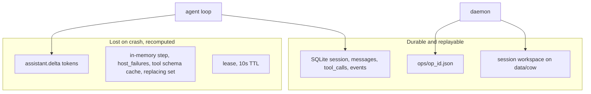
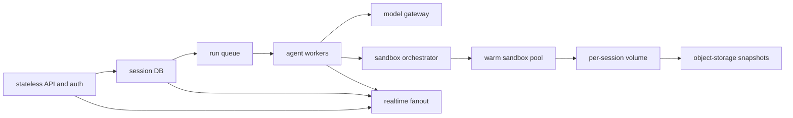

# Fault tolerance and scale for this coding agent

The prototype in [PLAN.md](PLAN.md) is a single-machine proof that a ReAct loop can resume after the backend or a daemon dies. Those rules are the right ones to keep. They do not survive a second machine, a second writer, or a tool that is not a file edit.

Two numbers drive the rest of this note. "Millions of users" is a registration and storage problem. The expensive problem is concurrent running agents. A plausible peak for a product with about 1 million registered users is on the order of 100k daily actives and a few thousand to a few tens of thousands of agents running at once, plus many more idle browser connections. Size the fleet for that peak, not for 1 million sandboxes.

## What already works, and should stay

These invariants in the prototype are the production design, not throwaway demo tricks.

- **One owner per kind of state.** SQLite owns conversation, tool rows, leases, and host records. `data/cow/` owns files. The UI owns nothing and can reload.
- **Commit before side effect.** [backend/agent.py](backend/agent.py) writes the assistant message and `pending` tool rows in one transaction after the model stream finishes, and writes the tool result in the same transaction that appends the tool message.
- **Deterministic ids.** `op_id = {session}.{step}.{call_index}` in [backend/store.py](backend/store.py). Session create uses `Idempotency-Key`.
- **At-least-once tools, made safe by the journal.** [daemon/journal.py](daemon/journal.py) returns a stored result for a repeated `op_id`. File tools are written so a second run is harmless: atomic replace, `already_applied`, `exist_ok`, delete-if-absent.
- **Lease fencing.** Claims use `BEGIN IMMEDIATE`. Later writes include `AND lease_owner = :me`. A stale owner gets `LeaseLost` and stops.
- **Host identity.** `boot_id` changes on process start. `generation` increments on replace. `docker rm -f` runs before the new container starts, so two daemons are not supposed to write one session.
- **Shared workspace.** Both containers bind-mount the same `data/cow/`, which is why migration after `MIGRATE_AFTER_S` (20s) can resume the same files.

Crash windows the demo already covers: die during the model stream (nothing committed, call the model again), die after the assistant row commits (pending tools run), die during a tool call (same `op_id` replays or reruns), die after the daemon replied but before SQLite commit (journal replay).

## Failures the prototype can still hit

These are real gaps in the current code, even with one user.

**A host can get stuck in** `replacing`**.** [backend/scheduler.py](backend/scheduler.py) `observe` returns `"busy"` when `status == "replacing"` and never starts recovery. `replace_host` only clears that status on success (`mark_replaced`) or on a 30s timeout (`force_down`). If the backend is killed mid-replace, the new process sees `replacing`, refuses to touch the host, and every session pinned to it waits until `host_give_up_s` (60s) and then fails. The "kill both" demo hits this window.

`generation` **is recorded, not enforced.** Tool calls store `host_generation`, but `call_tool` does not reject a stale generation. The only fence is `docker rm -f` on the same machine. A container that survives `rm`, or a second backend that also calls Docker, can still accept work.

**The op journal lock is in-process.** Workspace create uses `fcntl.flock` in [daemon/workspace.py](daemon/workspace.py). The journal uses `threading.Lock` only. Two daemon processes that both miss `ops/<op_id>.json` both run the tool. One backend avoids this because it waits for `docker rm -f` before retrying. Two backends, or a timeout retry against a live daemon on another host, do not.

**Timeout versus still-running.** `TOOL_TIMEOUT_S` is 60. On timeout, `report_failure` probes `/health`. If the host answers, it is marked healthy and the same `op_id` is retried. The same daemon serializes that retry on the journal lock, so file tools are safe. A migrated host does not share that lock.

**Model calls are at-least-once and billed twice.** Nothing is written before `llm.chat`. A crash, a 429, or a lease loss after the stream still costs a full completion. Retries in [backend/agent.py](backend/agent.py) use `min(30, 2 ** (attempt - 1))` with no jitter, then fail the session after 5 tries. A provider blip fails user work instead of parking it.

**Cancel does not stop the in-flight call.** [backend/store.py](backend/store.py) `cancel_session` clears the lease, so the next SQLite write raises `LeaseLost` and drops the result. The HTTP stream to Grok and the daemon call run until they finish.

**Leases use wall clock.** `lease_expires_at` is `time.time()`. An NTP step can expire every lease at once, or keep a dead owner's lease alive. Renewal is every 3s with a 10s TTL. Anything that stalls the event loop for longer than the TTL lets a second owner start. Scheduler methods call SQLite directly on the event loop (`record_health_success`, `get_session` inside `wait_for_host`), while the agent correctly uses `asyncio.to_thread`. A slow `BEGIN IMMEDIATE` stalls health, renewal, and streaming together.

`waiting_host` **holds a concurrency slot.** Default `MAX_CONCURRENT` is 10. A session waiting on Docker still occupies one of those 10 tasks. Ten stuck hosts means the runner claims nothing else.

**Replace is not retried as its own state machine.** Timeout marks the host `down` and returns. The health loop will try again, but `_replacing` is memory-only, and a crash during `docker rm` / `docker run` has no persisted "recovery step" to resume.

**One volume, no quotas, no cleanup.** Session directories and `ops/*.json` are never deleted. The base tree is immutable only by convention. A write into `data/cow/base/` would change every session that has not yet copy-on-written that path. `atomic_write` is per file; a tool that must update two files can leave the pair half-applied, and the journal then replays the success of a partial logical edit.

**Isolation is a Python check.** Every daemon bind-mounts all of `data/cow/`. Path checks live in the tool process. There is no auth on `:8080`, `:8090`, or `POST /api/hosts/{id}/kill`. `docker.sock` is effectively in the control plane. One bad tool, or one open kill endpoint, sees every workspace.

## What breaks as concurrency grows

Ordered by which limit you hit first.

**1. The single writer.** [backend/db.py](backend/db.py) is one SQLite connection, one `threading.Lock`, `synchronous=FULL`. Every claim, heartbeat, token-adjacent event, and tool finish takes that lock. A running session writes several transactions per step (llm started, commit turn, mark running, finish, step advance). A few hundred active sessions, or a few thousand SSE reconnects replaying `events`, saturate one file. WAL lets readers proceed; it does not add writers.

**2. The event log and the in-process bus.** `events.seq` is one global `AUTOINCREMENT`. [backend/events.py](backend/events.py) `publish` enqueues every event onto every subscriber queue, and the queues are unbounded. Session filtering happens after the enqueue in the API stream. At a few thousand browsers this is memory growth and a GIL bottleneck. Ephemeral `assistant.delta` frames make it worse: they are the highest-rate messages and they are not durable, but they still fan out through the same process as the agent loop.

**3. The runner is a poller, not a queue.** [backend/runner.py](backend/runner.py) wakes every 1s, claims up to free slots, and keeps the lease only while the asyncio task exists. There is no fair share per user, no priority, no delay queue for "try again in 5 minutes," and no separation between "waiting on the model," "waiting on a human," and "runnable." `list_sessions` returns every row, newest first, with no cursor.

**4. Two hardcoded hosts.** [backend/config.py](backend/config.py) only knows `host-a` and `host-b`. Placement is least session-count, ignoring CPU, disk, and repo size. Health is one process polling every 2s. Replacement shells out to `docker` on fixed ports with no memory, CPU, pid, or network limits. That stops being an architecture around tens of concurrent sandboxes, not at a million users.

**5. The shared directory.** Hardlinks in [daemon/fsutil.py](daemon/fsutil.py) only work on one filesystem, and Docker Desktop often falls back to a full copy. `ensure_session` walks and fsyncs the whole tree. A real repo (git history, `node_modules`, build output) turns session create into a metadata storm. Migration in [backend/scheduler.py](backend/scheduler.py) only works because both hosts see the same files. The moment hosts are on different machines, a dead host takes its dirty workspace with it unless something else has the bytes.

**6. The model, before the computers.** Each step resends the full transcript. Token cost grows roughly with the square of the step count. A 50-step task at tens of thousands of input tokens is dollars, not cents, and prompt caching is the difference between a product and a bill. Provider 429s are amplified by the synchronized backoff. `list_tools` is cached for the life of the process, so a tool-schema change is invisible until restart.

**7. Multi-user correctness, which the schema does not have.** Idempotency keys are global, not per user. There is no user id, no authz on session read, no spend cap, no retention. `POST /api/sessions` with a collided key returns someone else's session.

## The production shape

Keep the step machine. Replace each single-process implementation with a component that has the same job and a real failure domain.

**API tier.** Stateless replicas behind a load balancer. Authn on every route. Idempotency keys scoped to `(user, key)`. Rate limits and a concurrency cap per user, checked before a row is admitted. Create session inserts a durable row and returns. The request does not run the agent. Kill-host and kill-backend disappear from the public API; crash injection stays in an admin path.

**Session database.** Postgres (or equivalent) replaces SQLite. Same tables, with `user_id`, a cursor on events, and partitions or a retention job for `events`. Claims become `SELECT … FOR UPDATE SKIP LOCKED` or, better, a queue message whose visibility timeout is the lease. Fencing stays: every transition carries a lease token, and a writer with an old token affects zero rows. Use the database clock or a monotonic lease version, not a raw client wall clock. `synchronous` durability stays; it moves to the database's replication (sync commit to one replica, async to the rest) so one disk is not the outage.

**Agent workers.** Horizontally scaled, no local session state. One leased session per task. The loop in [backend/agent.py](backend/agent.py) can move almost unchanged: reload from the DB, decide `model` / `tools` / `advance` / `done`, commit, repeat. Workers must heartbeat the lease faster than the TTL, and abort the HTTP calls when the lease is lost or the user cancels. On deploy, drain: stop claiming, finish or checkpoint the current step, exit. A killed worker is the same recovery as today's SIGKILL.

**Realtime.** Do not hold SSE clients in the worker. Workers append the durable event, then publish a small notice. A separate fanout tier (Redis, NATS, or a hosted pubsub) pushes to connections. Deltas are best-effort and droppable under backpressure. Durable events are not. Reconnect still uses `Last-Event-ID` against the database, which the prototype already does. Filter by session before the message crosses a process boundary.

**Model gateway.** A narrow client in front of Grok, not a framework. Per-tenant token bucket, jittered backoff, a cap on in-flight completions, prompt-cache breakpoints on the stable prefix, and a hard spend limit that parks the session instead of failing it. Record the provider request id when one exists. Streaming cancel must close the socket. Fallback model is optional; a second provider with a different tool-call dialect is a product decision, not a scaling requirement. Log token counts and error class. Do not log raw prompts into an unbounded debug sink.

**Sandbox orchestrator.** This is the scheduler that [PLAN.md](PLAN.md) deliberately left inside the backend. Workers ask for a sandbox; they do not run Docker. The orchestrator keeps a warm pool, places by free CPU and memory, and enforces cgroup limits, a non-root user, a read-only root filesystem, and a default-deny egress proxy. `generation` and `boot_id` stay. Replacement is "destroy this VM, attach the same volume to a new one," which is a stronger fence than `docker rm -f`. Health checks are per node from a cluster agent, not one Python loop curling every sandbox.

**Workspace storage.** Stop bind-mounting one tree into every sandbox. Each session gets its own volume or overlay, built from a read-only base image of the repo (container snapshot or a git clone plus a dependency cache), not from hardlinks on a laptop disk. Dirty state is local SSD while the sandbox runs. On pause, shutdown, or every N successful steps, snapshot to object storage so a dead machine does not lose the workspace. Restore is how migration works across hosts. Delete or lifecycle the snapshot when the user deletes the session. Quotas on disk, inodes, and snapshot size are part of admission control.

**Op journal, upgraded.** Keep `op_id`. Store the result with a compare-and-swap create (`O_EXCL` or a conditional DB insert of a `started` marker) before the tool runs, and include a hash of the arguments. A replay with different arguments is an error, not a silent return of the old body. The marker is what makes two workers safe. The journal lives with the workspace snapshot so a rescheduled sandbox still sees it.

## The hard fault: tools that are not file edits

File tools are idempotent, so at-least-once plus a journal is enough. A production coding agent has to run tests, package installs, git, and formatters. Those are not idempotent, and a crash between "process started" and "journal written" will run them twice.

The durable pattern:

1. Persist `op_id`, args hash, and state `started` before the exec.
2. Take a workspace snapshot, or run the command in a sandbox whose disk can be rolled back.
3. Run the command.
4. Persist stdout, stderr, exit code, and state `finished` with the same `op_id`.
5. On resume, if `finished` exists, return it. If `started` exists and the sandbox is known dead, restore the snapshot and run once more. If the sandbox might still be running, attach or kill it before the second run. Never start a second exec against a live one.

That is the production version of [daemon/journal.py](daemon/journal.py). Without the snapshot, the honest choices are a small allowlist of idempotent commands, or accepting duplicate side effects. `replace_in_file`'s `already_applied` heuristic does not generalize to shell.

Parallel tool calls are a related limit. The prototype runs `call_index` order, one at a time. Parallel exec only stays correct if each call has its own snapshot or the calls are known not to touch the same paths. Start with serial execution; add parallelism after the journal fence exists.

## Sizing, in the order it will hurt

Planning assumptions, not measurements: a task is about 20 to 100 model turns and several minutes of sandbox time; an active user might run a handful of those per day.

- **Model spend and 429s** bind first. Prompt caching, per-user budgets, and jittered retries matter before any new database.
- **Concurrent sandboxes** bind next. A few thousand warm 1–2 vCPU, 2–4 GB VMs is a real cluster plus a warm pool. Cold start has to be seconds or less, or the queue has to hide it.
- **Workspace bytes** bind for the registered base. A million historical sessions cannot live as directories on one disk. Hot volume on the sandbox node, cold snapshot in object storage, lifecycle rules.
- **SSE connections** can exceed running agents by 10x. They belong on the fanout tier, with idle timeouts.
- **The session database** needs to absorb several writes per step per running agent, plus heartbeats. That is comfortable for Postgres at a few thousand agents if events are batched and old events are archived. It is not comfortable for one SQLite file.
- **Regional failure** is a later requirement: one region with replicated DB and snapshots copied to another region is enough until users are actually multi-region. Do not start with active-active writers on the same session.

Operational SLOs worth defining before rewriting anything: time to first token, recovery time after worker death (today bounded by the 10s lease), rate of replayed tool calls, rate of duplicate model completions, sessions failed because a host stayed `replacing` or `down`, and dollars per completed task.

## What not to build yet

The prototype does not need Kubernetes, a second region, or a plugin tool runtime to teach the next lesson. The next real step, when you want one, is a narrow slice: move leases and events to a database that allows two worker processes, make host recovery resumable when status is `replacing`, and put `fcntl` or an exclusive create around the op journal. That is the smallest change that keeps today's crash demos and exposes the multi-writer bugs. Sandbox orchestration, auth, and snapshot restore come after two workers can share one session safely.

Shell execution should not be added on top of the current journal. Add it only with the started-marker plus snapshot rule above, or keep the daemon file-only as it is now.